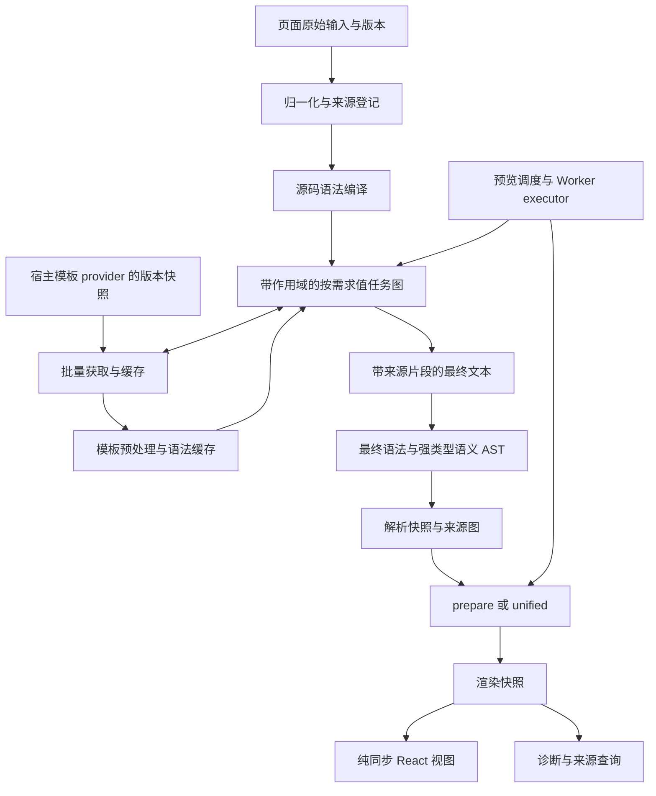

# 实时预览与模板展开整体改造实施方案

文档类型：实施方案（Informative）

制定日期：2026-11-12

状态：主体已实施（2026-11-12）。来源图、统一快照、parser 编译/构建分离、编译器与 provider、缓存、批量调度、语义修复、视图来源属性、`/preview` 与 `/worker` 已落地，并通过 `typecheck`、`lint`、格式检查与全量单元测试。剩余收尾项见文末“实施记录”。本文仍作为目标形态与验收条件的依据。

授权范围：整体改造实时预览涉及的源码模型、parser 编译路径、模板展开、缓存、诊断、准备、视图、Worker 与公共接口。允许破坏性变更，不提供旧 API 别名、旧快照迁移或兼容分支。设计以整体正确性、使用成本和维护成本为准。

实施期间，路线图只登记本方案入口；方案与当前实现说明冲突的部分按阶段实施，同步更新规范。全部完成后，把最终规则写入架构、parser 接入、渲染规范、开发约定与公共文档，再删除本方案。

## 1. 改造目标与边界

把当前“每次创建展开引擎，输出文本后重新解析”的路径改造成可复用的编译器：展开在带来源信息的任务图中执行；缓存归编译器实例管理；最终输出、诊断和 DOM 定位共用同一份来源图。

交付结果必须支持：

- 页面原始输入、LF 归一化文本、模板原文、模板有效正文和展开结果之间的来源查询。
- 模板内嵌套调用、调用方参数与多次引用的正确作用域和定位。
- 跨编辑复用模板源码与编译结果；按版本失效，容量受控。
- 按需批量获取、受控并发和可取消等待；输出与诊断不依赖网络返回顺序。
- 常用字符串函数与 MediaWiki 1.43 的已支持语义一致。
- 一次配置即可在渲染结果中启用块级定位；编辑器不需要逐标签覆盖组件。
- 统一的实时预览调度接口，同时支持主线程与宿主创建的 Worker。
- 新快照在 Worker 传输、序列化恢复、prepare、unified、视图和 devtools 中完整保留来源信息。

本方案继续遵守项目的交付边界：npm 交付库；playground 通过公共入口验收，不构建、不部署、不发布。parser 仍锁定项目指定的单一上游版本；不复制或改写上游实现。模板网络、鉴权和站点配置由宿主提供。

改造重点是实时预览所需的编译能力，不扩展为完整编辑器 SDK。编辑器选区、自动滚动、键盘响应、历史记录和站点业务仍由宿主决定。Lua、任意站点扩展与服务端 HTML 后端不作为客户端编译器的新增能力。

## 2. 已核验的基线

基线为提交 `ba3beac`、包与本地 dist 0.3.0。已有展开测试全部通过，但不能据此认为下面的差异已覆盖。

| 项目 | 已核验事实 | 改造结论 |
| --- | --- | --- |
| 同名参数嵌套 | `T = [{{{1}}}]`，`{{T|{{T|x}}}}` 在本库得到 `[{{T|x}}]` 并报循环，上游得到 `[[x]]` | 按调用方作用域重建循环检测；不放开模板体自递归 |
| 字符模型 | `#len:😀` 得到 `2`；`#sub:😀\|0\|1` 产生单独的高代理码元 | 字符串函数按 Unicode 码点处理，源码 offset 继续按 UTF-16 表示 |
| `#sub` 边界 | 显式长度 `0` 和负长度当前得到错误的空结果 | 同时修复参数默认值与截取语义 |
| `#replace` 空查找串 | 当前保留输入；MediaWiki 将空查找串按单个空格处理 | 纳入已支持函数的语义修复 |
| 模板解析 | 每次展开创建新缓存；末尾 LF 会触发模板二次解析 | 改为实例缓存，拆出语法编译和语义构建，减少无用解析 |
| 获取顺序 | resolver 按求值顺序串行等待 | 改为任务图中已确定需求的批量获取 |
| 原有扩展能力 | 宿主可包装 parser 做跨调用缓存；可用统一 rehype 插件写定位属性 | 提供正式公共能力，复用元数据与扩展点，不重复建设另一套来源系统 |
| 现有映射 | 仅顶层调用记录；这一限制已写入公共指南 | 整体替换为来源图和嵌套调用记录 |
| fallback | `document` 返回原始 LF 快照，记录的展开范围被改回原始范围 | 保留真实阶段身份，不修改失败尝试的坐标含义 |
| include | 混合、嵌套组合已有语义与上游测试；指南中的嵌套限制与实测矛盾 | 先纠正文档事实，再将过滤纳入有映射的预处理 |
| 容错与预算 | 未闭合 `{{` 原样保留且无诊断；调用次数预算去重，深度和长度逐点诊断 | 保留合理容错，统一诊断数据与呈现粒度 |

实现核验入口：[`src/expand/`](../../../src/expand/)、[`tests/expand/`](../../../tests/expand/)、[`src/parser/index.ts`](../../../src/parser/index.ts)、[`src/hast/types.ts`](../../../src/hast/types.ts)、[`src/view/bridge.tsx`](../../../src/view/bridge.tsx)。

外部语义依据是 MediaWiki `REL1_43` 的 ParserFunctions 与 PPTemplateFrame_Hash，以及项目锁定版本的上游 expander。上游 expander 用于可覆盖语义的开发期对照；上游自身不支持或与站点有分歧的行为，以官方实现和固定站点夹具为依据。禁止以“同名模板总是循环”或“JavaScript 字符串天然等价于站点字符语义”代替验证。

## 3. 最终架构



核心分为可共享的纯数据和每次编译独立的执行状态：

| 层 | 拥有的数据和职责 | 不共享的执行状态 |
| --- | --- | --- |
| Source graph | 文本源、变换关系、映射片段、调用和输出出现位置 | 不保存编辑器或网络对象 |
| Parser | 配置快照、语法编译、语义构建能力和有效选项 | 不保存模板作用域或编译预算 |
| Compiler | provider、LRU 缓存、依赖索引和可观测统计 | 每次 compile 有独立任务图、预算、诊断和取消域 |
| Evaluator | 不可变 frame、参数 thunk、分支需求和输出片段 | 调用路径属于 frame，不使用引擎共享标题栈 |
| Scheduler | 收集确定需求、批处理、并发上限和稳定提交 | provider 返回顺序不决定记录顺序 |
| Prepare / view | 继承来源图，转换和展示有效快照 | 不获取模板，不持有 compiler 可变状态 |
| Preview | 防抖、请求版本、旧结果展示、取消和 executor | 不在 render 中启动工作 |

按责任拆开 `ExpansionEngine`。最终不得保留一个继续负责解析、获取、函数、参数、预算和映射的大类，也不得通过新包装层保留旧的 `MutableExpansionRecord` 和共享 `stack`。

## 4. 统一源码与快照模型

### 4.1 文本源身份

所有可对外传递的源码范围改为带来源身份的对象。旧的二元 range 只可作为 parser 内部的 `OffsetRange` 使用，不能继续出现在 diagnostic、origin、resolver 请求、组件属性或公共查询中。

```ts
type WikitextSourceId = string;

interface WikitextSourceSpan {
  readonly sourceId: WikitextSourceId;
  readonly start: number;
  readonly end: number;
}

interface WikitextTextSource {
  readonly id: WikitextSourceId;
  readonly key: string;
  readonly revision: string;
  readonly role: "input" | "normalized" | "template" | "effective" | "expanded";
  readonly text: string;
  readonly title?: string;
}
```

范围统一为 UTF-16 `[start, end)`；行列是从所属文本源计算的派生数据，通过查询函数获得，不再与 span 分别存储一份可失配的公开 position。

`input` 完整保留编辑器提交的原文，`normalized` 保存 LF 文本。CRLF 与单个 CR 的替换也记录映射，页面和模板使用同一规则。模板的原文、LF 文本与 include 过滤后的有效正文分别登记，不能把有效正文偏移称作模板原文偏移。

source id 必须区分页面、模板、版本与变换阶段。身份生成确定，不依赖 render 时的随机数、时间或组件挂载顺序。相同标题的不同内容不能共用身份；查询必须检查文本源存在、范围合法和快照身份。裸 `page:original` / `template:Foo` 不能作为充分的版本身份。

### 4.2 统一来源图

来源图保存为普通数据，包含 source catalog、变换片段、调用记录及输出出现位置。关系通过 id 引用；缓存索引、Map、WeakMap、对象父指针和查询方法不写入序列化数据。

- 直接复制的片段记录等长对应关系。
- CRLF 替换、include 删除和边界换行记录显式变换。
- 参数片段沿调用方来源传播；参数重复使用产生不同输出出现位置。
- 函数转换的结果按实际能力标记来源；无法逐字符对应时关联产生结果的调用。
- 生成的分隔符、填充和展示节点具有生成原因，不伪造页面精确范围。
- 嵌套调用保留自身所在文本源、父调用、作用域身份、状态及多个输出范围。

来源关系用图表达。同一模板源码的范围可对应多个展开位置；输出节点还可能同时来自模板正文、页面参数和生成内容。调用关系与源码片段关系分别建模，不能把整套结构压成单一文本树。

诊断、AST origin、HAST 元数据和 DOM 查询均引用这个模型。语义节点 id 仍仅在快照内有效；实时调度不得把旧快照的 node id 直接用于新快照。

### 4.3 快照形态

保留解析快照与渲染快照的不同职责，统一加入 `kind`、快照 id、活动 source id 和来源图。公共 View、Context、自定义组件与查询统一使用 `snapshot` 命名，直接移除旧 `document` 属性。

- `WikitextParsedSnapshot`：语义 AST、可选语法树、活动源码、来源图、诊断与解析元数据。
- `WikitextRenderSnapshot`：插件处理后的语义 AST、HAST、来源图、诊断、标题与渲染设置。
- `WikitextCompilation`：编译状态、输入/实际输出/失败尝试的 source id、解析快照、依赖清单和统计。诊断与来源图只保存在其 `snapshot`，不在外层复制另一份。

`prepareWikitext(compilation.snapshot)` 把来源图传入渲染快照；unified 做相同处理。普通 `parseWikitext` 也生成包含原文与 LF 变换的最小来源图，不能让静态与展开路径使用两套 range 类型。

AST、syntax、render schema 与编译封装版本继续表达各自的数据格式。此次整体更新相关版本并拒绝旧快照，不为简化字段而混淆包版本、parser 版本和数据 schema。序列化与恢复保留快照的判别类型，恢复时校验来源引用、映射、调用、各类预算和最终 HAST 安全性。

### 4.4 fallback

编译的活动快照总是与其活动 source id 一致：

- `complete`：受支持且实际求值的调用全部完成。
- `partial`：有保留调用、未解决依赖或受支持函数产生的可见错误结果。
- `fallback`：最终语义解析失败，活动快照使用原始 LF 源码。

fallback 不改写尝试展开的 output span。保留 attempted source 和失败诊断；失败阶段映射无法建立时明确记录失败原因。返回原始 AST 可以延迟构建并复用初始语法编译结果，无需每次提前构建一份原始语义树。

最终总长度或来源数据超过硬上限且不能生成完整有效快照时，整次编译失败；不截断文本或伪造来源。

## 5. 来源查询与 DOM 定位

### 5.1 映射接口

映射接口必须表达多段结果、映射覆盖率与精度，不能只返回一个 range。建议形态如下；落地时在公共类型与类型测试中固定精确字段。

```ts
interface WikitextMappingMatch {
  readonly from: WikitextSourceSpan;
  readonly to: WikitextSourceSpan;
  readonly precision: "exact" | "enclosing-invocation";
  readonly invocationId?: string;
  readonly occurrenceId?: string;
}

interface WikitextMappingResult {
  readonly matches: readonly WikitextMappingMatch[];
  readonly unmapped: readonly WikitextSourceSpan[];
  readonly coverage: "complete" | "partial" | "none";
  readonly truncated: boolean;
}
```

提供 `mapSourceSpan`、`locateRenderedNode`、`findRenderedNodes` 与 `getSourcePosition`，共享来源图查询实现。映射可限定目标 source、调用实例或输出出现位置。结果按明确的源码顺序排序；重复模板出现位置全部返回，不任选第一个。

`exact` 模式允许多段和部分结果，无法映射的子范围进入 `unmapped`。`enclosing-invocation` 用于点击预览返回页面调用位置，明确标注粗粒度。生成字符、被删除片段内部的点和无法证明对应关系的函数结果不能冒充精确映射。点映射单独定义左右边界偏向，覆盖 CRLF 内部位置、零长度输出、删除和相邻调用边界。

精确性按可证明的边界对应判断。完整 CRLF 与归一化后的 LF 可按变换边界对应，CR 与 LF 之间的内部 offset 没有唯一对应点；不能按比例插值。多阶段映射组合后不得提升精度；粗粒度关联只用于定位产生结果的调用，不参与精确往返保证。查询使用可重建的区间索引，并限制遍历与结果数量；达到上限返回明确的截断状态，不能把未返回的匹配当作不存在。

### 5.2 来源属性

所有 View / Fragment 路径通过同一最终属性生成器支持 `sourceAttributes: "none" | "block" | "all"`，默认 `none`。启用时输出：

- `data-wikitext-snapshot`：当前快照身份。
- `data-wikitext-node`：当前快照中的语义节点 id。
- `data-wikitext-source`、`data-wikitext-start`、`data-wikitext-end`：有直接活动源码范围时提供。

复杂、多源或生成节点只输出真实存在的身份与来源，不把多个范围压成一个字符串。宿主通过 node id 查询完整来源图。

`block` 覆盖段落、各级标题、列表项、定义列表项、表格结构、引用正文、块级扩展、HTML 块和源码降级块；分类、目录、表格补位等生成结构按生成节点规则处理。块级判定依据语义与转换结构，不依据任意站点 CSS 的 `display`。`all` 覆盖可关联语义节点的元素，不承诺给独立文本节点制造额外 wrapper。

HAST 已有来源元数据作为基础，组件覆盖与 rehype 插件继续使用它。finalize / restore 保留可信元数据，清洗器为库生成的属性保留名称，过滤源码伪造同名属性。HTML 与语义组件覆盖都收到来源属性和相同的定位信息；自定义组件主动丢弃属性时，文档说明宿主应按公共 props 转发。

宿主用容器事件委托与 `closest` 获取身份，经快照校验后定位源码。库不默认添加 `tabIndex`、`role=button` 或点击动作。需要交互时，宿主自行提供键盘和无障碍语义。DOM 属性和正式查询完成后，playground 删除重复的标签覆盖和私有位置换算。

## 6. Compiler、provider 与缓存

### 6.1 实例接口

`/expand` 改为编译器入口，以 `createWikitextCompiler` 为主要公共 API。移除原 `expandWikitext`、`templates` / `resolveTemplate` 双来源配置和只能表示顶层记录的类型；内部调用、文档与 consumer 一次性迁移，不保留兼容包装。

```ts
const provider = createTemplateTableProvider({
  key: "offline:demo",
  revision: "templates-v1",
  templates,
});

const compiler = createWikitextCompiler({
  parser,
  provider,
  cache: { maxEntries: 500, maxBytes: 16 * 1024 * 1024 },
  fetch: { concurrency: 4, batchSize: 50 },
});

const compilation = await compiler.compile(
  { key: "page:demo", revision: "edit-42", text: source },
  { pageName: "Demo", signal, failureMode: "preserve" },
);
const snapshot = prepareWikitext(compilation.snapshot, prepareOptions);
```

提供 `compile`、`invalidate`、`clearCache`、`getStats` 和 `dispose`。实例配置固定 parser 与 provider；更换配置创建新实例。单次编译可提供页面上下文、解析/展开预算、保留语法树和取消信号。

示例中的容量和并发是起始配置，不是未经测量的性能保证。实现应给出有效默认值和完整选项校验；所有预算使用安全整数，零值是否合法按对应语义明确规定。

### 6.2 Provider 快照

provider 提供 `open`，接收页面上下文并返回本次编译固定的模板来源快照。快照包含来源 key、版本、`get`、可选的 `getMany` 和可选的 `release`；请求包含规范化标题、页面上下文和实际调用来源。返回值包含标题、源码和内容版本；缺失用明确的缺失结果表示。

- 一次 compile 使用同一个来源快照，编辑期间模板更新不会把两个版本混入一个结果。
- 模板表 helper 在构造时校验并复制一次；后续 compile 复用。更新表构造新版本，不接受可变 Map 冒充不可变 provider。
- 远程 provider 负责鉴权、重定向策略、站点数据、限流和 I/O。库调用注入方法，不自动猜测站点 URL。
- 标题作为模板查找身份；调用来源用于诊断与访问上下文。同一来源快照对同一标题必须返回稳定内容，不能根据 caller 悄悄改变源码。
- `getMany` 返回按标题索引的结果；允许返回顺序不同，但缺少请求标题或返回错误类型按获取失败处理。
- provider 的来源 key / 版本必须区分站点与授权内容域。不会共享用户私有内容的宿主可主动复用 compiler；默认不创建模块级网络缓存。
- 页面上下文会改变模板内容时，`open` 返回的 key / revision 必须区分这些上下文；不得用未包含该差异的缓存键复用结果。
- 若远程源无法固定版本，宿主给每次打开的会话独立 revision，跨调用只复用已带可靠内容版本的语法结果。

compiler 管理每次 `open` 对应的会话引用；成功、失败和取消都释放本次引用。共享获取任务另持会话引用，最后一个订阅者退出并且底层任务结束后，才调用对应的 `release`，且只调用一次。任务使用独立的取消信号，不绑定第一个调用者的 signal。compiler 的 `dispose` 取消所有自有任务并释放自有会话，不销毁宿主提供的 provider。

### 6.3 缓存与依赖

缓存分层：

| 缓存 | 键必须包含 | 失效与生命周期 |
| --- | --- | --- |
| 模板获取结果 | provider key、provider snapshot revision、规范化标题 | 版本变化失效；缺失仅在可靠版本内复用；瞬态错误不跨 compile 缓存 |
| 模板预处理 / 语法程序 | parser 实例身份、有效配置与语法预算、模板页面上下文、归一化内容、预处理规则版本 | 纯结果可跨标题共享时仍保留必要的页面上下文；容量受控 |
| 页面语法编译 | parser 身份、输入内容、有效 parse options | 静态或未变文本复用；最终语义树按需要构建 |
| 编译依赖索引 | 本次实际读取的标题、内容版本与未命中项 | 用于定向失效和调试，不收录未选择分支 |

不缓存带某次快照身份的可变 frame、参数结果或输出映射。缓存语法程序使用相对偏移，组装快照时绑定实际 source id。不能把旧编译中的 diagnostic / invocation 直接返回给新页面。

解析预算变化必须重新检查缓存是否满足新预算，低预算不能绕过检查。parser 配置在实例创建时固定；自定义 parser 的缓存身份和语法/预处理能力需要显式声明。源码、页面名、parser 版本或预处理规则变化，都不能命中不适用的结果。

LRU 同时限制条目数与占用字节，超大条目可计算但不入缓存。统计区分命中、未命中、淘汰、字节量、语法编译次数和 provider 请求数。`dispose` 释放索引与缓存并终止归实例所有的未完成工作；实例之间没有隐式共享。纯派生 WeakMap 索引允许保留，避免把所有模块级 memoization 一概视为污染。

`invalidate` 与 `clearCache` 推进缓存代次；旧代次的未完成任务不能在返回后重新填入已失效条目。已开始的 compile 继续使用其固定 provider 快照，之后的 compile 重新取值；模板内容变化必须更新 provider revision，不能仅靠清缓存表达内容版本。依赖清单归编译结果所有，compiler 的反向索引随缓存条目淘汰而清理，不累计每次编辑的历史记录。

并发 compile 共用缓存时，未完成获取采用带订阅者的任务。取消某次 compile 只移除该订阅者，全部订阅者取消后才中断底层请求；已取消结果不提交到该次快照。源码已获取且版本可靠时，纯语法缓存可正常复用。

## 7. 语法编译与语义修复

### 7.1 Parser 路径

重构 parser 协议，明确区分源码语法编译与语义构建。`parseWikitext` 仍提供普通同步解析，但调用与 compiler 相同的语法/归一化实现。

- 初始页面只编译调用结构；最终展开文本再构建语义 AST，避免为每份模板和原始页面创建无需使用的完整语义树。
- 模板预处理返回有效文本和变换片段；默认适配器提供与其配置一致的注释 / opaque 扩展扫描能力。
- include 处理、LF 归一化和去尾换行在语法编译前完成，常见模板只编译有效正文一次。
- 自定义 parser 必须提供编译所需的语法与保护区域能力；缺失时报明确的不兼容错误，不根据未声明的站点标签猜测。
- 过滤导致新语法边界时按有效文本重新编译；不通过简单减 offset 假装旧语法树仍然正确。
- 保留现有 parser IIFE 捕获、版本检查与配置快照机制；优化应发生在本库分层，不改写上游 bundle。

### 7.2 Frame 与参数

每个 frame 包含不可变的模板祖先路径和词法父作用域。参数 thunk 捕获调用方 frame；读取参数时在捕获的作用域求值，复用该参数已经得到的值和来源片段。

模板体调用新模板时，沿该词法 frame 的模板路径检查循环，再建立子 frame。参数中的调用不使用正在展开模板体的路径。因果调用关系可指向外层调用，循环检测仍以参数捕获的词法作用域为准。

必须同时验证：

- `T = [{{{1}}}]`，`{{T|{{T|x}}}}` 得到 `[[x]]`，无循环诊断。
- 模板正文调用自身、相互调用以及参数默认值形成的真正循环仍被检测。
- 参数重复读取复用求值结果，但每次输出出现位置独立登记。
- 参数覆盖顺序、空值、未使用默认值、动态参数名和命名参数 trim 与 oracle 一致。

参数值和参数名的求值规则分别验证。不能因为参数值惰性，就推断所有动态参数名都不需要求值。

### 7.3 已支持函数

将函数注册、参数读取策略、值转换和结果来源分开组织。每个函数明确哪些参数必须求值、哪些分支惰性、怎样生成错误输出，以及结果可以提供何种映射。

- `#if`、`#ifeq`、`#switch` 缺分支参数返回空字符串，保留站点一致的行为。
- `#switch` 标签按匹配过程读取；匹配后不获取后续未需要的标签或分支值。
- `#iferror` 按站点错误标记规则检测，覆盖注释、nowiki 和 raw 扩展处理；不得把库 diagnostic 的存在直接替代可见输出判定。
- `#len` / `#sub` 以 Unicode 码点为字符单位，明确不以字素簇计数。组合字符与非 BMP 分开测试。
- `#sub` 省略或显式长度 `0` 取到末尾；负长度从结果末尾缩短；开始位置的正负与越界按站点实现验证。
- `#replace` 的空查找串等价于单个空格，非空查找串按完整字符序列替换。审阅支持的替换次数和长度约束，无法支持的参数必须明确处理。
- 当前支持的大小写、padding、表达式、标题、URL 和 tag 函数同步检查整数解析、空白、实体、错误标记与输出长度，不能只修复已发现的示例。

受支持函数的错误输出按站点语义生成，并记录有来源的诊断；不把每个错误都变成原始调用字符串。尚未支持的函数、Lua 和 modifier 在 `failureMode: "preserve"` 下原样保留，状态为 partial；`throw` 下抛出带来源的错误。

### 7.4 include 与输入容错

include 预处理输出实际删除、保留和拼接片段。以现有混合与嵌套 oracle 用例建立支持矩阵，新增注释、opaque 标签、属性引号、大小写、自闭合、非法闭合和 onlyinclude 优先关系。单遍扫描不等于不支持嵌套，也不默认把同名标签改为 HTML 栈式配对。

未闭合 `{{` / `{{{` 在编辑中的普通容错文本不得被 strict 模式随意升级为展开失败。为不完整输入、补全闭合、快速删改和相邻完整调用增加回归，确认状态、输出和来源一致。

## 8. 按需求值、批量与并发

并发集中在 scheduler 的模板获取层，纯求值由确定顺序的任务图驱动。不得在旧 evaluator 上直接用 `Promise.all`，也不得仅添加一个 `concurrency` 选项后继续共用可变标题栈。

执行方式：

1. 按调用结构建立任务；记录稳定的源码地址、参数作用域和依赖。
2. 在确定顺序的求值轮次中执行纯计算，直到得到当前真正需要的模板集合或完成结果。
3. 排除缓存命中，按 provider 快照去重，形成确定的需求批次。
4. 支持 `getMany` 时按 batch size 切分；否则在并发上限内调用 `get`。批次数量和每批内容不依赖 RTT。
5. 等待当前需求批次后，按固定任务地址提交获取结果、诊断与预算结果，再推进下一轮。
6. 输出片段按原源码结构组装，计算来源图和最终调用记录。

独立顶层调用和已经确定需要的函数参数可形成同一需求批次。动态标题、嵌套模板和 `#if` 条件等未解决依赖需先完成，不能提前抓取猜测到的分支。`#switch` 的匹配顺序不得因批处理改变。

所有调用次数预算在确定的任务顺序中分配，后续轮次使用相同规则；获取完成不能直接扣除语义预算。预算不足的任务不会触发新获取。网络并发设为 `1` 或更大值时，任务图、请求标题集合、输出、调用状态和诊断顺序应相同。资源预算采用明确的新调度规则，不要求复制旧串行实现的内部遍历方式。

热缓存只减少实际工作，不改变逻辑求值轮次、调用预算分配或分支选择。缓存命中的依赖也在其对应轮次提交，不能提前递归推进并抢占后续调用预算。相同输入、provider 版本、选项与预算在冷缓存、热缓存和部分命中时，输出、调用状态、依赖集合和诊断必须相同；实际网络请求数与统计允许不同。

同一个 provider snapshot 的标题可以合并请求；每个调用仍保留独立来源和状态。批量失败明确展开为对应标题的获取失败，不吞掉整个批次的上下文。

取消检查覆盖：排队、provider 等待、各求值轮次之间、最终解析前后和 prepare 前后。同步 parser 无法抢占；Worker executor 可以终止执行域。部分请求取消和 compiler dispose 使用一致的所有权规则。

## 9. 诊断、预算与失败

diagnostic 使用带来源的主 location，另可附 related locations、invocation id、发生次数和稳定排序键。主 location 保留真实失败位置：模板体失败指向模板源；页面调用位置作为相关来源。需要在编辑器展示时显式投影到输入源，投影结果包含精度，绝不就地改写原诊断。

解析、展开和准备产生的诊断进入活动快照的统一集合，以 stage 区分来源。删除三套同形但坐标域不同的诊断集合。错误对象也使用同一 source span 模型，避免 Promise 拒绝与快照诊断再次分叉。

预算处理采用“全局摘要 + 受影响调用状态”：

- 每类预算每次 compile 生成一条摘要，包含实际配置、首次位置、影响数量和有限的相关位置。
- 调用记录保存预算受限原因，devtools 可逐点展开；摘要不复制无界的位置列表。
- 正常缺失模板、获取失败和语义错误保留按发生位置的诊断，允许宿主按码聚合显示。
- 全局输出、单个结果、任务数、模板源总量、映射片段数、诊断数量和缓存内存均有独立上限。
- 来源图超限会明确使该次编译失败，不能悄悄丢失映射后仍宣称完整精度。

`failureMode` 只控制已定义的可恢复失败。原始解析失败、硬资源上限、取消和不兼容 parser 始终失败。用户输入不完整的容错与预算超限是不同事件，不能用一个“严格程度”开关混合处理。

## 10. 实时预览、Worker 与入口

### 10.1 公共预览接口

新增独立 `/preview`，提供 `useWikitextPreview`、executor 协议和 Worker transport。它不加载默认 parser；工作通过显式 executor 发起。

```tsx
const preview = useWikitextPreview({
  input: { key: pageKey, revision: editorRevision, text: source },
  executor,
  debounceMs: 250,
  initialSnapshot,
});

return preview.snapshot ? (
  <WikitextView snapshot={preview.snapshot} sourceAttributes="block" />
) : (
  <LoadingPreview />
);
```

hook 暴露当前输入 revision、展示快照 revision、`idle` / `scheduled` / `running` / `ready` / `error` 状态、错误，以及立即执行和取消操作。调度期间可保留旧快照，但旧快照的身份和版本不变；用户点击旧结果时返回旧版本定位，宿主不能把它当作当前输入的范围。

首次输入立即执行；同一输入 key 的后续编辑防抖；key 变化取消旧执行并隔离旧页面结果。executor、有效选项或来源版本变化也触发新请求。effect cleanup、unmount、Strict Mode 重放和执行返回乱序都不能提交过期结果。

渲染期不调用 executor、不创建 compiler、不启动 provider 请求。compiler / executor 的构造归宿主显式生命周期；SSR 的 `initialSnapshot` 由宿主提前编译并与客户端一致。effect 中处理异步工作可以保持纯 render，但不会在服务端自动产生展开结果。

根入口保留同步 `<Wikitext source={...}>` 的便利路径，并整体改用新快照模型和新 View 属性。实时异步编排统一使用 `/preview`，不再新增另一套组件专属展开配置。该选择是避免重复状态与所有权的设计决定，不宣称异步组件本身违反 React 规则。

### 10.2 Worker executor

新增 `/worker`，提供 worker handler；宿主创建 Worker 和决定 URL / bundler / CSP。handler 内复用 compiler，执行 compile 与 prepare，返回普通数据渲染快照。`/preview` 中的 transport 只连接宿主 Worker，不加载 parser。

协议包含 request id、输入 key / revision、有效选项、结果或错误、取消与释放消息。函数、compiler、provider 和 AbortSignal 不通过 `postMessage` 序列化。远程 provider 可在 Worker 内实例化；需要宿主鉴权的场景使用显式模板请求 RPC，并传播每次请求的取消状态。

定义取消方式：协作式取消停止排队和等待；需要硬中断同步 parser 时终止 worker 并重建执行实例，该实例内缓存随之失效。不得把普通取消消息描述为已经中断同步计算。

playground 保留 Worker 为主要执行路径，主线程 executor 作为明确回退。复用 hook / executor / 来源查询，删除 `useParseScheduler` 中与公共预览层重复的计时、请求身份和过期结果逻辑；配置选择和源码编辑仍归 playground 会话层。

### 10.3 入口与服务端路径

| 入口 | 最终职责 | 依赖边界 |
| --- | --- | --- |
| 根入口 | 同步源码组件 | React 与 parser |
| `/ast` | 快照、来源图、查询、序列化及类型 | 不加载 React 或默认 parser |
| `/parse` | 同步 parser 与普通解析 | parser，不加载 React |
| `/expand` | compiler、provider helper、展开类型 | parser，不加载 React |
| `/hast` / `/unified` | prepare 与插件处理 | 不加载默认 parser 或 React |
| `/view` | 同步快照视图、组件与 context | React，不加载 parser |
| `/preview` | hook、executor 协议、worker transport | React，不加载默认 parser |
| `/worker` | compile / prepare worker handler | parser 与准备工具，不加载 React |
| `/devtools` | AST、来源、调用、诊断检查 | React 与公共数据工具，不加载默认 parser |

更新 tsdown entry、exports 生成、client banner、Vite aliases、类型 consumer 和入口隔离测试。不要借此次改造顺带把所有入口重命名为 `/core` 或引入无关的 `/server` 后端。

公共指南区分：客户端 compiler 只执行已支持子集；`expandtemplates` 返回展开 wikitext，可由宿主交给 parser，但缺失内部来源时只声明粗粒度；`action=parse` / Parsoid 的 HTML 输出走宿主 HTML 展示与安全处理路径，不能当作 wikitext 再解析。Parsoid 的调用元数据与一般页面来源能力不等于任意模板内部双向映射。不得笼统承诺服务端路径总是更快或请求更少。

## 11. 模块替换与实施顺序

推荐的新模块按职责组织，目录名可随最终代码调整，依赖方向必须一致：

| 目标模块 | 负责替换或整合的上下文 |
| --- | --- |
| `src/ast/sourceGraph/` | 归一化、来源 catalog、span 校验、图序列化、查询与投影 |
| `src/parse/` | parser 协议、语法编译、保护区域扫描、普通解析入口 |
| `src/expand/compiler.ts` | 实例生命周期、compile、配置、失效与统计 |
| `src/expand/provider.ts` / `cache.ts` | provider 快照、表 helper、LRU、获取去重与依赖索引 |
| `src/expand/program/` | 有效模板语法程序、函数描述与参数读取策略 |
| `src/expand/evaluate/` | frame、thunk、任务图、输出片段及语义求值 |
| `src/expand/scheduler.ts` | 需求批次、预算分配、并发、提交和取消 |
| `src/hast/` / `src/view/` | 来源元数据、finalize、restore、源码属性与统一 View props |
| `src/preview/` / `src/worker/` | hook、executor、transport 与 handler |
| `src/devtools/` / `playground/` | 以公共图查询替换私有映射和调度 |

### 阶段 A：固定语义和测量基线

新增本次已经发现的真实语义回归夹具，记录预期与官方依据。建立包含小页面、大模板表、重复模板、Unicode、嵌套参数和延迟 provider 的分阶段基准。保留旧实现同环境结果，后续用相同输入比较。

完成条件：能独立复现同名参数误判、函数差异和重复解析；基准覆盖模板复制、预处理、语法、求值、最终语义、prepare、传输与视图，不把所有时间统称为 parse。

### 阶段 B：来源和 parser 基础

整体替换公共 range / origin / position 模型，接通普通 parser、语义归一化、prepare、序列化、unified 和查询。建立 source graph 与版本校验；组件和 Context 改用 snapshot。

完成条件：普通解析路径 CRLF 可映射；source 引用全部可验证；新的解析与渲染快照可恢复；没有仍向外泄露旧 tuple range 的路径。

### 阶段 C：编译器和纯求值

实现 provider 快照、语法缓存、不可变 frame、参数 thunk、函数语义与带来源的片段输出。以新 compiler 替换旧展开入口，移除共享标题栈、顶层记录和三套诊断集合。

完成条件：同名参数嵌套、真正递归、字符串函数、include、partial / fallback 和跨调用复用全部成立；嵌套与重复来源能查询，旧 evaluator 不再承担运行路径。

### 阶段 D：批量调度与资源控制

加入确定需求轮次、getMany、有界获取、预算摘要、共享未完成请求与取消。对 cache 和 source graph 加入容量统计与上限。

完成条件：不同网络返回顺序和并发值产生相同语义结果与调用需求；取消单个订阅者不影响其他编译；低预算不会因缓存命中绕过验证。

### 阶段 E：视图和实际预览

实现统一 source attributes、节点双向查询、preview hook 与 worker handler；playground 用公共接口替换重复实现。devtools 显示活动源码、模板原文、调用路径、映射精度和预算影响。

完成条件：点击模板输出可跳到页面调用或模板原文；重复模板能选择实际出现位置；旧快照不会误定位当前输入；Worker / 主线程结果等价。

### 阶段 F：产物和文档收敛

整体更新中英文 API、模板指南、故障排查、代码示例、导出面和 consumer。删除旧函数、类型、字段、测试 helper、私有定位插件与无效设计限制。

完成条件：项目要求的提交前检查与相关运行验收通过；当前实现说明反映新行为；本方案已完成的信息进入对应规范，本方案入口与文件可以删除。

阶段可拆分为可验证提交，但最终交付只有新实现。中间替换结构只用于同一开发分支，不发布长期双实现，不以旧测试期待错误行为作为兼容要求。

## 12. 验收与性能判定

### 12.1 行为验收

| 范围 | 必须覆盖的实际行为 |
| --- | --- |
| 作用域 | 同名参数、模板体递归、相互递归、默认值、动态标题 / 参数名、重复参数读取 |
| 函数 | 非 BMP、组合字符、`#sub` 零/负长度、`#replace` 空查找、分支惰性、错误标记 |
| 来源图 | CRLF、include 删除、隐式换行、跨片段范围、生成结果、零长度、模板重复、多源节点、fallback |
| 缓存 | 同实例热缓存、实例隔离、来源版本、页面上下文、parser 与配置、预算变化、缺失更新、瞬态失败、字节淘汰、失效期间旧请求返回、依赖索引清理 |
| 调度 | getMany / get 等价、网络乱序、并发变化、未选中分支不获取、冷 / 热 / 部分命中预算一致、共享请求取消、会话释放 |
| 诊断 | 真实模板位置、页面调用投影、精度、摘要影响数、排序、硬上限、错误对象来源 |
| 视图 | block / all / none、多实例、Fragment、组件覆盖、可信属性、源码伪造、生成节点 |
| Preview | 首次执行、防抖、页面切换、选项变化、旧结果、unmount、Strict Mode、乱序、SSR 初始快照 |
| Worker | 真实浏览器 / Worker 运行、协作与硬取消、模板 RPC、主线程回退、序列化来源图 |
| 集成 | prepare / unified 等价、devtools 来源查询、restore 清洗和预算、ESM/CJS、view-only / preview 入口隔离 |

以行为测试为主，避免仅镜像实现或检查内部函数调用名称。来源图增加属性测试：所有 span 在所属源内、复制片段的文本一致、精确映射可按出现位置往返、生成和删除片段不会被误标为精确。对受限的资源生成器检查上限，测试本身不创建无界数据。

oracle 测试不进入运行时；官方夹具注明版本、配置和预期，站点依赖用例不在普通 CI 发请求。源码 offset 与字符串字符模型分别测试，不为了 #len 改成码点 offset 而破坏编辑器定位。

### 12.2 性能验收

报告记录端到端及分阶段耗时、provider 请求数、批次数、语法编译次数、cache 命中/淘汰/字节量、映射片段数、快照传输量和峰值占用的可观测指标。

必须可验证的工作量变化：

- 同一不可变模板表不在每次编辑时重新遍历复制。
- 未变模板的热编译复用语法程序；常见尾 LF 模板不先构建原始语义树再重建有效正文。
- 当前确定需要的独立标题可以批量或并发获取，未选分支不产生请求。
- 反复编辑与版本切换后，缓存和来源数据受上限约束。
- 映射与序列化的新增成本单独记录，不把网络减少带来的改善掩盖为纯计算加速。

耗时按项目既有同环境相对比较规则呈现，不设虚构的固定毫秒目标。若某项性能回退，报告对应输入、阶段、收益和代价；不能只凭 O(n)、RTT 或缓存命中判断最终交互速度。

### 12.3 项目检查与完成条件

执行贡献指南要求的格式、lint、typecheck、全量测试；本方案改动同时涉及入口、产物、视图、playground、文档与性能，应执行 consumer、生产浏览器、e2e、无障碍、预算、docs build 和 bench 的对应检查。命令与版本以 `package.json`、CI 和 [CONTRIBUTING](../../../CONTRIBUTING.md) 为准。

最终清理须确认：

- 所有公开 span、diagnostic、组件属性、resolver 上下文和序列化字段已经迁移。
- `expandWikitext`、旧 `WikitextExpandedDocument`、顶层-only 记录、旧 document prop 和兼容 aliases 已移除。
- playground 没有私有 compiler、调度或 source map 副本，没有从 `src/` 绕过公共导入。
- 架构、parser 接入、渲染规范、开发约定与中英文页面同步，路线图移除已完成事项。
- 更新“CRLF 无映射”“展开仅顶层映射”“嵌套来源映射 / 编译快照序列化为非目标”等被本方案替代的决定；其他限制按实际实现保留。
- 新依赖或第三方代码变化已按合规规则登记；不复制上游 PHP 或 expander 实现。
- 检查结果、性能对比与仍存在的真实限制能够由代码和固定夹具复核。

## 13. 官方语义依据

- [MediaWiki ParserFunctions，REL1_43](https://github.com/wikimedia/mediawiki-extensions-ParserFunctions/blob/REL1_43/includes/ParserFunctions.php)：分支、错误标记、长度、截取和替换规则。
- [MediaWiki PPTemplateFrame_Hash，REL1_43](https://github.com/wikimedia/mediawiki/blob/REL1_43/includes/parser/PPTemplateFrame_Hash.php)：模板 frame 与调用方参数展开。
- [React：Components and Hooks must be pure](https://react.dev/reference/rules/components-and-hooks-must-be-pure)：render 纯度与 effect 的区别。
- [React：useEffect](https://react.dev/reference/react/useEffect)：异步返回乱序、cleanup 与服务端执行边界。
- [MediaWiki API：Expandtemplates](https://www.mediawiki.org/wiki/API:Expandtemplates)、[Parsing wikitext](https://www.mediawiki.org/wiki/API:Parsing_wikitext)：展开 wikitext 与 HTML 输出的区别。

实现测试固定具体版本与夹具；上述链接用于查阅语义依据，不作为测试运行时依赖。

---

## 实施记录（2026-11-12，收尾 2026-11-13）

已完成：

- `src/ast/sourceGraph/`：源目录、片段关系、调用记录、映射/定位/行列查询、序列化校验。
- `src/ast/`：快照统一为 `WikitextParsedSnapshot` / `WikitextRenderSnapshot`，`origin` 改为带来源身份的 span，诊断改为 `location`/`related`；parser 协议拆出 `compile` / `build`。
- `src/expand/`：`createWikitextCompiler`、`createTemplateTableProvider`、LRU 缓存、批量获取、共享未完成请求、取消、不可变 frame 求值器与来源片段输出。
- 语义修复：同名参数后写覆盖、参数在调用方作用域求值、`#len`/`#sub` 按码点、`#sub` 零/负长度、`#replace` 空查找串、函数错误可见输出与预算汇总。
- `src/view/`：`snapshot` 属性、`sourceAttributes: "none" | "block" | "all"`；`src/preview/` 与 `src/worker/` 新增入口并在构建、别名、路径与导出中注册。
- 文档收敛：概念页（中英）改用编译管线、新的入口边界与术语；`rendering-spec` 7.3、`parser-integration` 4.5/5 按来源图与新快照重写；安全页与模板展开指南同步 provider 与快照措辞；`/preview`、`/worker` 页面进入侧边栏与入口总览。

验证结果（Node `v24.16.0`，`wikiparser-node@1.48.2`）：

| 检查 | 结果 |
| --- | --- |
| `tsc --noEmit` | 0 错误 |
| `oxlint` | 0 错误（16 条既有风格警告） |
| `oxfmt --check` | 通过 |
| `vitest run` | 58 文件 / 602 项通过 |
| `tsdown` | 通过，产物含 `preview`、`worker` 与 `"use client"` banner |
| `rspress build` | 通过 |
| consumer（dist ESM/CJS、9 个入口隔离、类型、Vite、webpack、view-only 双构建） | 通过 |
| Playwright `@consumer` | 9 项通过 |
| Playwright `@a11y` | 4 项通过 |
| Playwright `@budget` | 1 项通过 |
| Playwright `e2e`（playground） | 25 项通过 |
| `bench` + `validate-report` | 通过，报告见下 |

基准（本机中位数，10 次采样，提交 `ba3beac`，工作区 dirty）：

| 夹具 | 阶段 | 中位数 (ms) | IQR (ms) |
| --- | --- | --- | --- |
| article-20k | parse | 180.13 | 153.52–198.13 |
| article-20k | prepare | 22.01 | 20.86–24.37 |
| article-20k | prepare-clone | 5.48 | 5.11–6.14 |
| article-20k | prepare-plugin | 0.00 | 0.00–0.00 |
| article-20k | prepare-convert | 2.14 | 1.83–2.43 |
| article-20k | prepare-rehype | 0.00 | 0.00–0.00 |
| article-20k | prepare-assemble | 12.46 | 11.25–13.32 |
| article-20k | serialize | 15.10 | 14.95–15.30 |
| article-20k | restore | 11.98 | 11.73–12.71 |
| article-20k | render | 24.51 | 24.10–25.72 |
| dense-lists | parse | 57.09 | 46.36–72.95 |
| tables-references | prepare | 4.07 | 3.96–4.37 |
| provider-table-1k | copy | 0.07 | 0.06–0.14 |
| expand-repeated | expand | 73.10 | 65.92–85.07 |
| expand-repeated | expand:normalize | 0.00 | 0.00–0.01 |
| expand-repeated | expand:page-syntax | 25.21 | 23.37–38.19 |
| expand-repeated | expand:evaluate | 4.10 | 3.56–4.15 |
| expand-repeated | expand:fetch | 0.11 | 0.10–0.13 |
| expand-repeated | expand:template | 1.24 | 1.22–1.28 |
| expand-repeated | expand:assemble | 4.00 | 3.94–4.12 |
| expand-repeated | expand:final-syntax | 3.58 | 3.42–3.80 |
| expand-repeated | expand:build | 0.22 | 0.21–0.22 |
| expand-nested | expand | 2.52 | 2.42–2.62 |
| expand-degraded | expand | 0.92 | 0.86–1.00 |

阶段计时实现：`src/instrumentation.ts` 提供 sink 类型与测量函数，编译器与准备管线的 `profile` 选项按实例传入；编译器上报 `normalize` / `page-syntax` / `template` / `evaluate` / `fetch` / `assemble` / `final-syntax` / `build`，准备管线上报 `prepare-clone` / `prepare-plugin` / `prepare-convert` / `prepare-rehype` / `prepare-assemble`。基准在每次调用时传入采样器，并把每段作为独立阶段写入报告与摘要；`validate-report.mjs` 会检查全部必测阶段。

仍待完成：

- 删除本方案前再读一遍 `development.md` 与 `decisions.md`，确认没有与实现冲突的表述。

已决定不做：

- playground 调度层保持现状。公共 executor 的契约是“编译并准备、返回渲染快照”，而 playground 需要“解析一次、按选项多次准备”，其 worker 协议还携带配置键、预算与展开开关。为不让内部工具反向影响库本体，不扩展公共 API，也不改动 playground 架构；playground 继续复用公共编译、快照、图查询与视图。
